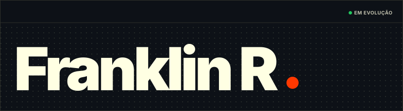
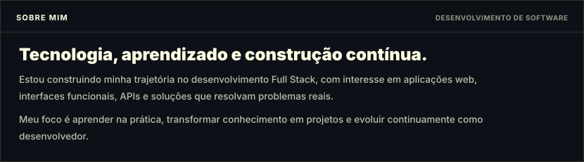
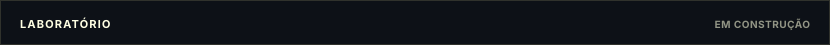
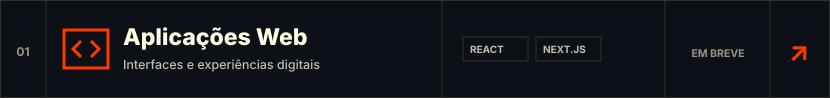
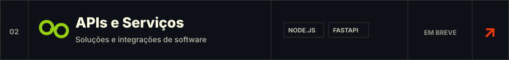
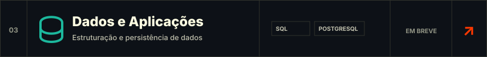
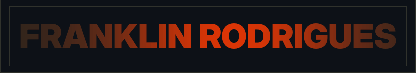

<!-- Gerado por scripts/gerar_perfil.py. Para trocar textos, edite config/perfil.json. -->

<picture>
  <source media="(prefers-color-scheme: light) and (max-width: 600px)" srcset="./assets/hero-m-light.svg" />
  <source media="(prefers-color-scheme: light)" srcset="./assets/hero-light.svg" />
  <source media="(max-width: 600px)" srcset="./assets/hero-m-dark.svg" />
  
</picture>

<picture>
  <source media="(prefers-color-scheme: light) and (max-width: 600px)" srcset="./assets/about-m-light.svg" />
  <source media="(prefers-color-scheme: light)" srcset="./assets/about-light.svg" />
  <source media="(max-width: 600px)" srcset="./assets/about-m-dark.svg" />
  
</picture>

<picture>
  <source media="(prefers-color-scheme: light) and (max-width: 600px)" srcset="./assets/stack-m-light.svg" />
  <source media="(prefers-color-scheme: light)" srcset="./assets/stack-light.svg" />
  <source media="(max-width: 600px)" srcset="./assets/stack-m-dark.svg" />
  
</picture>

<!-- Cada linha do laboratório tem seu próprio link clicável. -->

<picture>
  <source media="(prefers-color-scheme: light) and (max-width: 600px)" srcset="./assets/lab-header-m-light.svg" />
  <source media="(prefers-color-scheme: light)" srcset="./assets/lab-header-light.svg" />
  <source media="(max-width: 600px)" srcset="./assets/lab-header-m-dark.svg" />
  
</picture>
<a href="em-desenvolvimento/aplicacoes-web.md" title="Abrir área em desenvolvimento: Aplicações Web"><picture>
  <source media="(prefers-color-scheme: light) and (max-width: 600px)" srcset="./assets/lab-row-1-m-light.svg" />
  <source media="(prefers-color-scheme: light)" srcset="./assets/lab-row-1-light.svg" />
  <source media="(max-width: 600px)" srcset="./assets/lab-row-1-m-dark.svg" />
  
</picture></a>
<a href="em-desenvolvimento/apis-e-servicos.md" title="Abrir área em desenvolvimento: APIs e Serviços"><picture>
  <source media="(prefers-color-scheme: light) and (max-width: 600px)" srcset="./assets/lab-row-2-m-light.svg" />
  <source media="(prefers-color-scheme: light)" srcset="./assets/lab-row-2-light.svg" />
  <source media="(max-width: 600px)" srcset="./assets/lab-row-2-m-dark.svg" />
  
</picture></a>
<a href="em-desenvolvimento/dados-e-aplicacoes.md" title="Abrir área em desenvolvimento: Dados e Aplicações"><picture>
  <source media="(prefers-color-scheme: light) and (max-width: 600px)" srcset="./assets/lab-row-3-m-light.svg" />
  <source media="(prefers-color-scheme: light)" srcset="./assets/lab-row-3-light.svg" />
  <source media="(max-width: 600px)" srcset="./assets/lab-row-3-m-dark.svg" />
  
</picture></a>

<a href="mailto:rodrigues.tecnologia.dev@gmail.com" title="Enviar e-mail"><picture>
  <source media="(prefers-color-scheme: light) and (max-width: 600px)" srcset="./assets/contact-m-light.svg" />
  <source media="(prefers-color-scheme: light)" srcset="./assets/contact-light.svg" />
  <source media="(max-width: 600px)" srcset="./assets/contact-m-dark.svg" />
  
</picture></a>

<picture>
  <source media="(prefers-color-scheme: light) and (max-width: 600px)" srcset="./assets/assinatura-m-light.gif" />
  <source media="(prefers-color-scheme: light)" srcset="./assets/assinatura-light.gif" />
  <source media="(max-width: 600px)" srcset="./assets/assinatura-m-dark.gif" />
  
</picture>

